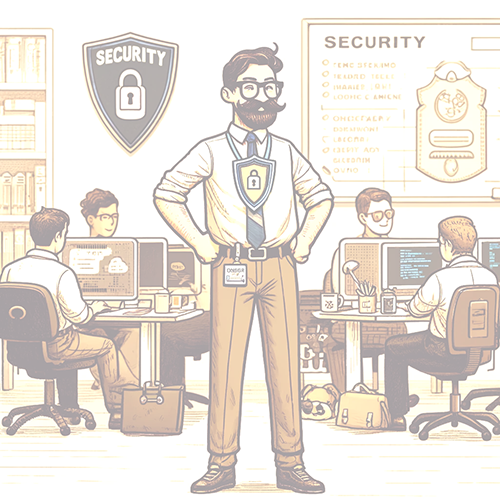

    

        
 
            Security Champion is an established role in many development organisations: someone on the team who keeps an extra eye on security, and who connects the formal security functions with the people actually building the solutions. The role does not require you to be a security expert — it requires someone who cares enough to ask the questions.
        

        

            Security is handled by the team as a whole, not delegated to one person. A Security Champion does not take on that responsibility, but makes sure it is not forgotten in a busy delivery. How the role is organised varies a great deal between companies — the articles below describe how we do it at Bouvet.
        

    

    

        
    

