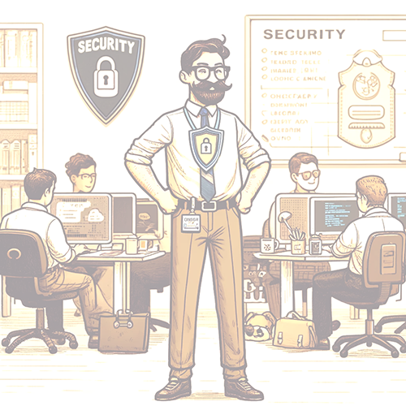

    

        
 
            Security Champion er en etablert rolle i mange utviklingsorganisasjoner: en person i teamet som holder et ekstra øye med sikkerhet, og som binder sammen de formelle sikkerhetsfunksjonene og de som faktisk bygger løsningene. Rollen krever ikke at du er sikkerhetsekspert — den krever at noen bryr seg nok til å stille spørsmålene.
        

        

            Sikkerhet skal håndteres av teamet som helhet, ikke settes bort til én person. En Security Champion overtar ikke ansvaret, men sørger for at det ikke blir glemt i en travel leveranse. Hvordan rollen organiseres varierer mye fra selskap til selskap — artiklene under beskriver hvordan vi gjør det i Bouvet.
        

    

    

        
    

